# Pokémon Red 30th Anniversary (PK30)

A Gen 9 rules fork of Shin Pokémon. Version 0.9.0. A Game Boy hack of Pokémon Red and Blue built on [Shin Pokémon](https://github.com/jojobear13/shinpokered) (jojobear13), which is built on [pret's pokered disassembly](https://github.com/pret/pokered). It keeps the Game Boy look and feel and brings in Gen 9 battle rules, abilities, held items, breeding and later-generation conveniences.

- **Made with AI.** This fork's code, data and documentation were written with an AI coding assistant (Claude, by Anthropic), directed and reviewed by the project owner.
- **Emulators and hardware.** The ROM works on [BGB](https://bgb.bircd.org/), a highly accurate emulator, so it should also run on real Game Boy / Game Boy Color hardware. Less accurate emulators may show Shin's "Emulator ERROR" warning on the title menu.
- **Compatibility.** Not compatible with genuine Pokémon cartridges (link trades and battles, Time Capsule), Pokémon Stadium 1 or 2, or Shin Pokémon or vanilla save files. It links only with itself.

Install: Download the BPS patch in Releases and apply it to a legitimate Pokemon Red ROM file.

Build: see [INSTALL.md](INSTALL.md) (`make` builds Red, Blue, Green, Red-JP, Blue-JP and the `_origback` variants). Tests: `make test` (PyBoy). Design record: [docs/design_brief.md](docs/design_brief.md). Shin's original README: [docs/shin_readme.md](docs/shin_readme.md). Every moveset change from Red and Blue: [docs/moveset_changes.md](docs/moveset_changes.md).

## Screenshots

<table>
<tr><td align="center">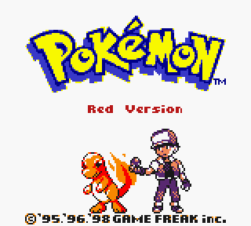 Title screen</td><td align="center">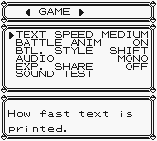 OPTION: GAME</td><td align="center">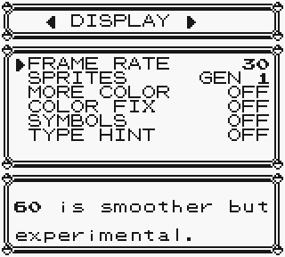 OPTION: DISPLAY</td></tr>
<tr><td align="center">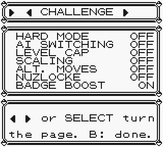 OPTION: CHALLENGE</td><td align="center">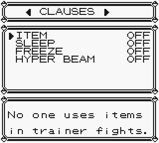 OPTION: CLAUSES</td><td align="center">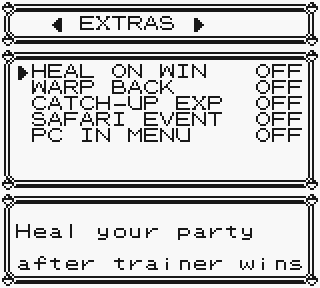 OPTION: EXTRAS</td></tr>
<tr><td align="center"> Category and effectiveness marks</td><td align="center">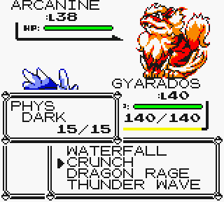 Dark type</td><td align="center">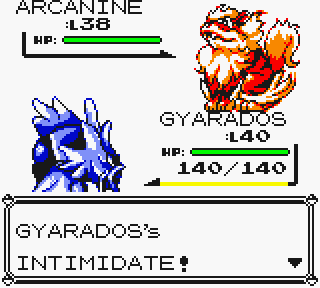 Abilities</td></tr>
<tr><td align="center">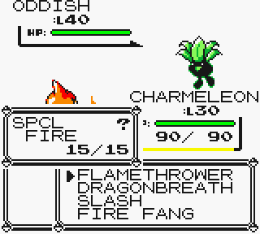 TYPE HINT: LEARNED, unseen</td><td align="center">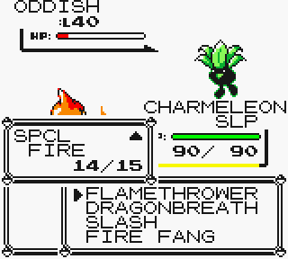 TYPE HINT: LEARNED, seen</td><td align="center">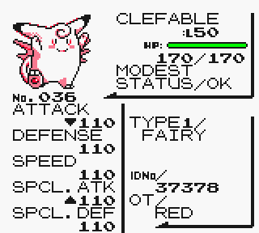 Status: nature, held item</td></tr>
<tr><td align="center">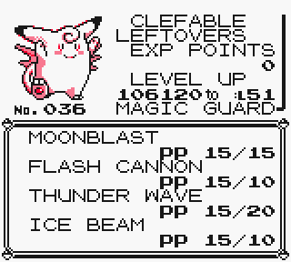 Status: ability</td><td align="center">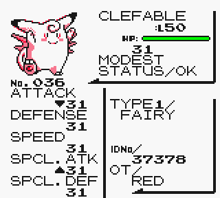 IVs (hold START)</td><td align="center">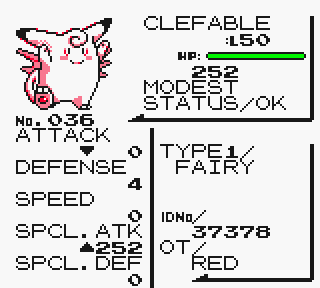 EVs (hold SELECT)</td></tr>
<tr><td align="center">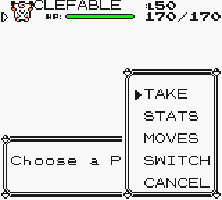 Party menu: TAKE</td><td align="center">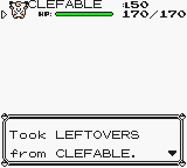 Taking a held item</td><td align="center">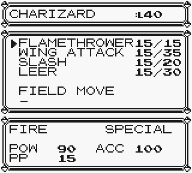 MOVES screen</td></tr>
<tr><td align="center">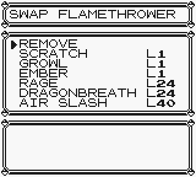 MOVES: learnset and TMs</td><td align="center">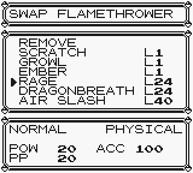 MOVES: move details</td><td align="center">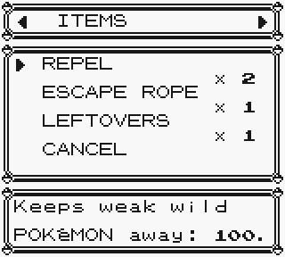 Bag: ITEMS</td></tr>
<tr><td align="center">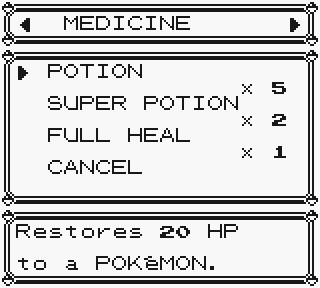 Bag: MEDICINE</td><td align="center">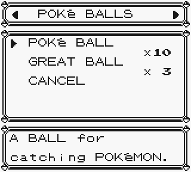 Bag: POKé BALLS</td><td align="center">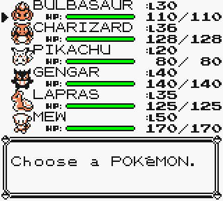 Party icons</td></tr>
<tr><td align="center">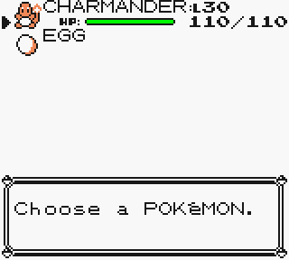 Egg in the party</td><td align="center">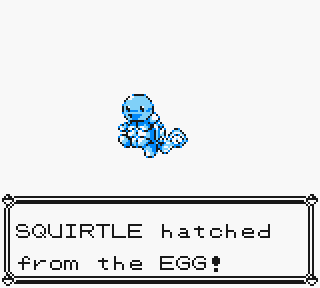 Egg hatching</td><td align="center">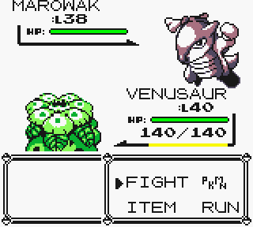 SPRITES: GEN 1</td></tr>
<tr><td align="center">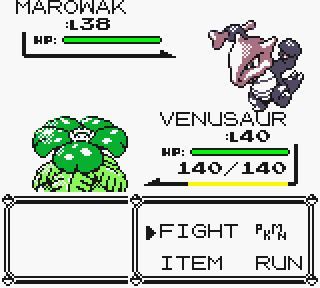 SPRITES: GEN 2</td><td align="center">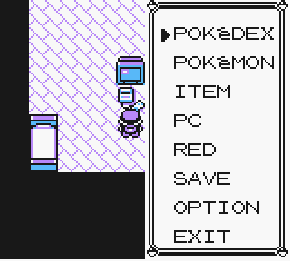 PC IN MENU</td><td align="center">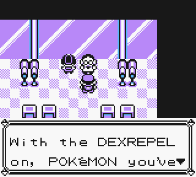 DEXREPEL explained (1/2)</td></tr>
<tr><td align="center">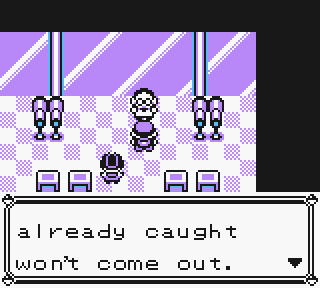 DEXREPEL explained (2/2)</td><td align="center">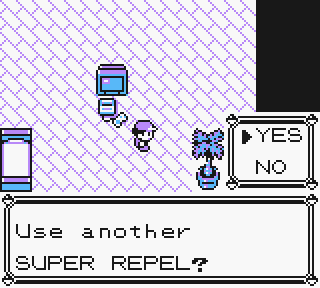 Use another repel?</td><td align="center">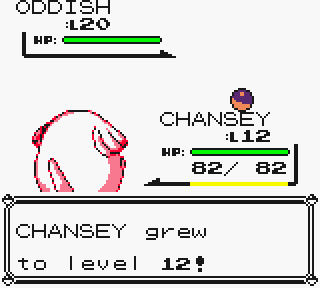 EXP on catch</td></tr>
<tr><td align="center">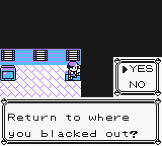 WARP BACK after a blackout</td><td align="center">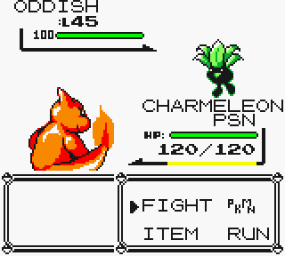 HP PERCENT</td></tr>
</table>

## Changes from Shin Pokémon (this fork)

Every option starts as the original game played; everything extra is off by default.

#### Battle rules (Gen 9)
- Physical/special split by move (Gen 4+ categories), not by type.
- Special split into Special Attack and Special Defense; Gen 9 values for every species.
- Gen 5+ damage formula with 16-bit stats; modifiers applied in Gen 9 order; 999 cap kept.
- Critical hits: Gen 9 stages (1/24, 1/8, 1/2, always), x1.5, ignore bad stages and screens.
- Stat stages use Gen 9 ratios; accuracy is one net stage (accuracy minus evasion).
- Stadium-style and speed-based crit rates removed.
- Burn halves physical damage instead of Attack; Explosion no longer halves Defense.
- Confused self-hit: 40 power, own Attack vs own Defense, never critical, ignores Reflect.
- Sleep 1-3 turns; freeze 20% thaw per turn; paralysis halves Speed, 25% full para.
- Confusion self-hit 1/3 of the time; poison and Leech Seed 1/8, burn 1/16.
- Toxic stays bad poison through a switch.
- Poison, burn, Leech Seed, binding damage, Leftovers and residual abilities happen at the end of the round, faster mon first (Gen 4+), not after each mon's move.
- Fainting works as in Gen 9: a mon that faints to a move is replaced only after the round's end-of-round effects, which the survivor still takes (none once a wild mon or a trainer's last mon faints); a mon fainting to poison doesn't stop the other's; Leech Seed and binding stop when their user is gone.
- Type immunities to status: Fire/burn, Ice/freeze, Electric/paralysis, Poison and Steel/poison.
- A move's side effect can now hit its own type (e.g. Body Slam paralyzes Normal types).
- Priority uses Gen 9 brackets (Quick Attack +1, Counter -5, Roar/Whirlwind/Teleport -6, etc.).
- Secondary-effect chances and high-crit moves are each move's Gen 9 values.
- Binding moves: 4-5 turns, 1/8 HP per turn, target can't switch; neither mon loses turns.
- Reflect, Light Screen and Mist last 5 turns as side conditions; Guard Spec. is Mist.
- Haze only resets stat stages.
- Multi-hit odds 35/35/15/15%; Gen 9 recoil fractions; crash damage is half max HP.
- Psywave does 50-150% of level; Low Kick power depends on target weight.
- Powder moves don't affect Grass types; never-miss moves skip the accuracy roll.
- Substitute: Gen 9 HP rules; sound and bypass moves go through it; drain moves hit it.
- Counter reflects any physical move (twice the damage).
- Disable, Mimic, Mirror Move, Bide and Rage follow Gen 9 (Rage: Gen 7).
- Conversion: user takes the type of its first move.
- Whirlwind and Roar force a random switch in trainer battles.
- Teleport switches the user out in trainer battles (not in link battles).
- Defrost moves (Flame Wheel, Flare Blitz) thaw a frozen user.
- Shin's trapping clause removed (binding no longer locks both mons).

#### Types
- Added Steel, Dark and Fairy with the Gen 6+ type chart.
- Gen 9 species types: Clefairy line and Mr. Mime Fairy, Jigglypuff line Normal/Fairy, Magnemite line Electric/Steel.
- Retyped moves: Bite Dark, Gust Flying, Karate Chop Fighting, Sand-Attack Ground.

#### Pokémon data
- Gen 9 base stats and catch rates (e.g. Pidgeot Spe 101, Pikachu 190, Kadabra 100).
- DVs and stat experience replaced by Gen 9 IVs (0-31) and EVs (252/510 caps).
- Gen 3+ stat formula; Gen 9 EV yields; Gen 7+ scaled experience formula.
- EXP. SHARE option (off by default): ON, the rest of the team gains half (Gen 9's always-on Exp. Share); OFF, only the mons that took part (or hold an Exp. Share) gain, unless EXP ALL is in the bag.
- x1.2 exp at or past evolution level; trainer-battle x1.5 exp bonus removed.
- Gender and shininess derived from IVs; shiny odds 1/4096.
- 25 natures (from IVs), +10%/-10%; trainer mons outside hard mode are Hardy.
- Hard-mode trainer mons get EVs (level x 85/100 per stat).
- Abilities: each species has its Gen 9 non-hidden abilities, chosen by an IV bit.
- Abilities: Adaptability, Anger Point, Arena Trap, Battle Armor, Blaze, Clear Body, Competitive, Compound Eyes, Cursed Body, Damp, Download, Dry Skin, Early Bird, Effect Spore, Filter, Flame Body, Flash Fire, Forewarn, Guts, Hyper Cutter, Illuminate, Immunity, Inner Focus, Insomnia, Intimidate, Iron Fist, Keen Eye, Levitate, Lightning Rod, Limber, Liquid Ooze, Magic Guard, Magnet Pull, Mold Breaker, Natural Cure, Neutralizing Gas, No Guard, Oblivious, Overgrow, Own Tempo, Pickup, Poison Point, Pressure, Reckless, Rivalry, Rock Head, Run Away, Scrappy, Serene Grace, Shed Skin, Shell Armor, Shield Dust, Skill Link, Sniper, Soundproof, Static, Stench, Sturdy, Swarm, Synchronize, Tangled Feet, Technician, Thick Fat, Tinted Lens, Torrent, Trace, Vital Spirit, Volt Absorb, Water Absorb, Water Veil.
- Abilities that would do nothing (weather and infatuation ones, and Sticky Hold) are replaced by the species' other ability, or its hidden ability if that works (Oddish Run Away, Gloom Stench, Vileplume Effect Spore); Exeggcute, Exeggutor, Tangela, Sandshrew, Sandslash, Magikarp and the Bellsprout line have none.
- Pickup finds Gen 3 items 10% after battle.
- Held items (52): BLACK BELT, CHARCOAL, DRAGON FANG, HARD STONE, MAGNET, MIRACLE SEED, MYSTIC WATER, NEVERMELTICE, PINK BOW, POISON BARB, SHARP BEAK, SILVERPOWDER, SOFT SAND, SPELL TAG, TWISTEDSPOON, METAL COAT, BLACKGLASSES, FAIRYFEATHER.
- Held items, continued: BERRY, GOLD BERRY, SITRUS BERRY, PRZCUREBERRY, MINT BERRY, PSNCUREBERRY, ICE BERRY, BURNT BERRY, BITTER BERRY, MIRACLEBERRY, MYSTERYBERRY.
- Held items, continued: LEFTOVERS, QUICK CLAW, KING'S ROCK, SCOPE LENS, BRIGHTPOWDER, FOCUS BAND, FOCUS SASH, LIGHT BALL, THICK CLUB, METAL POWDER, STICK, LUCKY PUNCH, CHOICE BAND, CHOICE SPECS, CHOICE SCARF, LIFE ORB, EVIOLITE.
- Held items, continued (outside battle): LUCKY EGG, EXP. SHARE, AMULET COIN, EVERSTONE, SMOKE BALL, CLEANSE TAG.
- Type boosters give x1.2 (Gen 9); Choice items lock the move until switching out.
- Give a held item by using it from the bag; TAKE on the party menu.

#### Moves
- Gen 9 power, type, accuracy and PP for the original 165 moves.
- Gen 9 effects: Acid lowers SpD, String Shot -2 Speed, Minimize +2 evasion, Waterfall/Rock Slide flinch, Dizzy Punch confuses.
- Tri Attack burns/paralyzes/freezes 20%; Growth raises Atk and SpA; Skull Bash raises Def.
- A Poison-type user's Toxic never misses.
- 49 new moves from the learnset audit: Aerial Ace, Air Slash, AncientPower, Aqua Jet, Brine, Bug Bite, Bug Buzz, Bulldoze, Close Combat, Cross Chop, Crunch, Disarming Voice, DragonBreath, Dragon Rush, Drill Run, DynamicPunch, Earth Power, ExtremeSpeed, Fire Fang, Flame Wheel, Flare Blitz, Flash Cannon, Giga Drain, Gunk Shot, Heat Wave, Hyper Voice, Icicle Crash, Incinerate, Leaf Blade, Liquidation, Low Sweep, Mach Punch, Moonblast, Pluck, Poison Fang, Poison Jab, Powder Snow, Psyshock, Razor Shell, Round, Seed Bomb, Shadow Ball, Sludge Bomb, Stomping Tantrum, Stone Edge, Twister, Water Pulse, X-Scissor.
- New moves reuse existing animations and sounds.
- Not implemented: Bug Bite/Pluck/Incinerate berry effects, Stomping Tantrum doubling, Twister vs flying mons.
- Learnset audit: all 249 recommendations applied (level-up learnsets and starting moves). Every Pokémon's changes from Red and Blue (Shin's and this fork's), the new moves and changed move data are listed in [docs/moveset_changes.md](docs/moveset_changes.md).
- Horn Drill and Guillotine removed from level-up learnsets.
- Evolving teaches the new form's level 1 moves (Gen 7+).

#### Menus and UI
- Move menu shows category (PHYS/SPCL/STAT) instead of "TYPE/".
- Move menu effectiveness marks (4x to immune); hidden against unidentified ghosts.
- Status screen: five stats, nature with raised/lowered marks, ability, held item.
- Status screen shows EVs with SELECT and IVs with START.
- MOVES screen (party menu): set any of four moves or the field slot from learnset or owned TMs/HMs.
- Party submenu is STATS, MOVES, SWITCH, CANCEL plus up to four field moves.
- Bag opens full screen with auto-sorted pockets: ITEMS, MEDICINE, BALLS, BATTLE ITEMS, BERRIES, KEY ITEMS.
- Bag holds 36 kinds; LEFT/RIGHT change pocket.
- OPTION screen: seven pages (GAME, DISPLAY, CHALLENGE, CLAUSES, EXTRAS, RANDOMIZER, RANDOM POKéMON) with two-line explanations.
- GAME: TEXT SPEED, BATTLE ANIM, BTL. STYLE, AUDIO, EXP. SHARE, SOUND TEST.
- DISPLAY: FRAME RATE, SPRITES, MORE COLOR, COLOR FIX, SYMBOLS, TYPE HINT, HP PERCENT.
- HP PERCENT: the enemy HUD shows its HP as a percentage number (Showdown-style, no % sign) in place of "HP:"; it counts up or down with the bar.
- CHALLENGE: HARD MODE, AI SWITCHING, LEVEL CAP, SCALING, ALT. MOVES, NUZLOCKE, BADGE BOOST.
- BADGE BOOST: Gen 1's badge boosts (each badge raises its stat of your Pokémon by 1/8; the Volcano Badge raises both specials), on by default. They never stack: a stat gets its boost only when it is worked out again. Turn them off here; link battles never have them.
- CLAUSES: ITEM, SLEEP, FREEZE, HYPER BEAM.
- EXTRAS: HEAL ON WIN, WARP BACK, CATCH-UP EXP, SAFARI EVENT, PC IN MENU.
- RANDOMIZER: DOORS, KEY ITEMS, ITEMS, MARTS, TRADES; RANDOM POKéMON: STARTERS, WILD, TRAINERS, SPECIAL MON, TM MOVES, TM COMPAT., LEARNSETS (see Randomizer).
- Defaults match the original game: MEDIUM text, SHIFT, 30 fps, no smart AI switching, COLOR FIX off, all extras off.
- Rule options can be set from the title screen before NEW GAME.
- TYPE HINT: OFF (default), ON, or LEARNED (only matchups seen in battle; "?" otherwise).
- PC IN MENU: start menu PC item opens the full PC (hidden in link rooms).
- Title screen: "Red 30th Anniversary" (Blue and Green in those builds) under the logo, in the original "Red Version" lettering; main menu shows version 0.9.0.

#### Randomizer
- Options on the RANDOMIZER and RANDOM POKéMON pages, all off by default, set from the title screen before NEW GAME (from the start menu they only show).
- DOORS: every door and staircase is shuffled, two-way (outside doors with insides, stairs with stairs). Red's house, Oak's lab, the Viridian mart (Oak's Parcel), the elevators and the Elite Four to Hall of Fame chain stay put; the S.S. Anne, Safari Zone, Silph Co., Rocket Hideout, Victory Road, Seafoam Islands and Pokémon Mansion keep their insides, with only their ways out shuffled.
- KEY ITEMS: key items and HMs are shuffled among item balls and gifts (DOORS turns it on). Badges are not shuffled. Hidden items and the Pokédex-count aides never hold key items.
- ITEMS: the other items in balls, hidden spots and gifts are shuffled, and each species' wild held items are another species'.
- MARTS: each mart (but Viridian's, the bike shop, Shin's special mart and the drink machines) sells Poké Balls, Potions and Escape Ropes plus a random pick from the other marts' items.
- TRADES: the in-game trades ask for and give other Pokémon of similar strength.
- STARTERS: RANDOM gives three different three-stage lines; TYPES three whose types beat each other in turn, like Grass, Fire and Water. The rival takes the one that beats yours, and keeps its line all game.
- WILD: OFF, TIER, FULL (Shin's swaps, now from the whole seed) or AREA: each encounter slot has its own basic Pokémon, evolved as far as its level allows; the land slots run through every basic Pokémon but the legendaries, so each can be caught somewhere; surfing and fishing give Water types. The Pokédex's AREA follows it.
- TRAINERS: OFF, ON (Shin's: regular trainers) or ALL: every trainer, gym leaders and Elite Four included, gets Pokémon of similar strength (base stat total), of their type theme if they had one (gym leaders and the Elite Four always), evolved as far as their level allows; no legendaries; the rival keeps the starter line; the bosses' Pokémon that held nothing hold a random battle item.
- SPECIAL MON: the legendaries, the Power Plant's, both Snorlax, Eevee, Lapras, the dojo's, the fossils, the Magikarp salesman's, the Game Corner prizes and the old man's Weedle become others of similar strength (legendaries stay legendaries).
- TM MOVES: each TM teaches a random move, no two the same; HMs stay.
- TM COMPAT.: who can learn the TMs: TYPE (always their own types, Normal half the time, others a fifth), RANDOM (half), FULL (everyone everything). HMs keep their own compatibility but with FULL.
- LEARNSETS: level-up and starting moves: TYPE (their own types half the time), RANDOM, or METRONOME only. A damaging move stays a damaging move, a status move a status move.
- NEW GAME asks for a SEED (up to 10 letters; none gives a random one). The same seed with the same randomizer options gives the same game, including RANDOM WILD and RANDOM TRNR.
- The world is checked to be finishable, with no place you can walk into and get stuck. Building it takes about 20 seconds on a Game Boy, 10 on a Game Boy Color, once per game.
- In a shuffled world (DOORS or KEY ITEMS), trainers' Pokémon more than 2 levels (bosses 3) above your highest, and wild ones above it, come down to it, as their pre-evolution if needed. Only down; SCALING still raises them.
- With DOORS: the S.S. Anne's sailor always takes the ticket, the Elite Four's door needs all 8 badges, and a Pokémon Center sets its own town for blackouts.

#### Breeding and day care
- Day care holds two Pokémon; both gain experience.
- Breeding as from Gen 6 (same egg group and opposite gender, or Ditto); replaces Shin's Cinnabar cloning lab.
- Egg chance 20/50/70% by species and original trainer; an egg can appear every 256 steps.
- Eggs inherit egg moves (Gen 9 data), shared learnset moves, three parent IVs.
- Mother's ability slot passed 80%; Everstone passes the holder's nature.
- Eggs hatch at level 1 with a hatch scene; Flame Body halves hatch time.

#### Items
- TMs and HMs are owned, reusable flags, not bag items; marts and prize corner won't sell owned ones.
- New item ZINC (raises SpD), sold with vitamins in Celadon; Calcium raises SpA only.
- Vitamins give 10 EVs up to the caps, at any level.
- Mist Stone sets all IVs to 31; M.Gene rerolls IVs at 16 or higher.
- EXP ALL: with EXP. SHARE off, the rest of the team gains half.
- DEXREPEL key item: Oak's aide, Route 12 gate 2F, for 80 kinds caught.
- DEXREPEL toggles on/off; while on, owned species don't appear (shinies still can).
- Held item sources: wild mons (23% common, 2% rare), gym leaders, Elite Four, champion.
- Marts sell type boosters (Celadon, incl. Metal Coat/BlackGlasses/Fairy Feather) and berries (Celadon, Saffron, Pewter, Cerulean).
- 18 field item balls now contain held items.

#### Quality of life
- HEAL ON WIN: full party heal after winning a trainer battle (not link; Nuzlocke dead stay dead).
- WARP BACK: after blacking out, offer return to where it happened (not Elite Four/Champion rooms, Safari Zone).
- Catching a wild mon gives the party experience and EVs (not Safari Zone).
- When a repel wears off, offers to use another of the same kind.
- NEW GAME+ keeps owned TMs/HMs and the TYPE HINT seen-matchup chart.

#### Graphics
- SPRITES option: GEN 1 (default) or GEN 2 (Pokémon Crystal fronts and backs, from pret's pokecrystal).
- Party icons: a two-frame icon per species from "MINIDEX 001-251" (Chamber, Solo993, Blue Emerald, Lake, Neslug, Pikachu25).
- Rocking two-frame egg icon.
- Gen 2 sprites keep Gen 1 palettes on Game Boy Color.

#### Bug fixes
- Enemy multi-hit moves used the player's level after the first hit.
- Enemy fully paralyzed or self-hit mid-Fly/Dig stayed invulnerable.
- Accuracy/evasion stage changes re-applied every badge boost to the player's stats.
- Transform desynced link battles (only the player's move index was reset).
- Gym leaders' and the Elite Four's special moves could give a mon the same move twice with trainer level scaling on.
- X Accuracy let a slower enemy land a one-hit KO move but not the player; in link battles this put the two games out of step.

#### Removed from Shin
- NPC and object rule toggles (rules are now options); Oak's Lab NPCs and Viridian house restored.
- The Shimmer.
- Cinnabar cloning lab (replaced by breeding).
- Saffron move deleter and relearner NPCs; teaching TMs from the bag (replaced by MOVES screen).
- SELECT-swapped second bag.
- Mid-game wild randomizer reseed; Safari event no longer locked until after the Elite Four.
- Trapping clause, enhanced Psywave, Gen 1 crit modes.

#### Internal
- Player/enemy battle routine pairs merged; PC box and day care moved to save RAM.
- PyBoy test harness, build comparison tool and link mirror test (`make test`).

#### Save/compatibility
- Pokémon data layout changed (IVs, EVs, held item); Shin saves are not compatible.
- Link handshake version 0.0.9.0: won't link with Shin builds.

#### Known issues
- Weather and infatuation are not implemented, so abilities needing them are left out (see Pokémon data).
- New moves reuse existing animations; a few secondary effects are not implemented (listed above).

## Changes from vanilla made by Shin Pokémon

#### Builds and versions
- Builds: Red, Blue, Green, Red-JP and Blue-JP (English), plus `_origback` variants that keep the original back sprites.
- Green/Red-JP: original Japanese graphics and Cerulean Cave layout, Pokédex text from FireRed, metric units.
- Blue-JP: Japanese Blue's encounters, trades, prizes and text, metric units.
- Original Red-JP/Green flashing move animations can be restored with the `_JPFLASHING` build flag.
- Restored the intro "Presents" in all builds.
- Patch version byte in the save; a version mismatch offers a warp to Pallet Town.
- Link revision check cancels links to incompatible builds; option to compile a female link partner.
- Emulator-accuracy checks show warnings on the title menu.
- GBC double-speed CPU mode is turned off for cable club and time capsule links.

#### Engine bug fixes: battle
- PP are tracked for wild and AI trainer Pokémon; non-link enemies are checked for 0 PP.
- Removed the 1/256 miss chance on all moves.
- Fixed the freeze when Defense is below 4, the wrong crit damage above level 127, and super-effective damage overflow.
- Each level gained is checked for new moves, on level-up and after evolving.
- Burn/paralysis stat penalties reapplied correctly after stat recalculation and on enemy send-out.
- Badge boosts don't stack, and boost only the stat that changed.
- A frozen player's Hyper Beam recharge is cleared; the player can pick a move while frozen (fixes desync).
- Switch-out message underflow fixed; PP Ups are ignored when checking for Struggle.
- BIRD type restored as TYPELESS (Struggle, Bide, Metronome).
- Counter: works against Typeless, last damage is cleared correctly, can't counter crash or confusion damage.
- Transform: can't reorder moves, copied-Transform PP capped, enemy DVs can't be manipulated, keeps its palette, Disable and level-up conflicts fixed.
- Disable can't crit or show effectiveness; its counter and odds corrected.
- Fly/Dig invulnerability cleared on full paralysis or confusion self-hit.
- Psywave min 1 damage and no underflow or overflow at levels 0, 1 or above 170.
- Substitute: blocks drain moves, Leech Seed, zero-power status moves and confusion side effects; can't leave you at 0 HP; takes recoil.
- Healing moves work at exactly 255/511 HP missing; Reflect/Light Screen capped at 999.
- Haze: no sleep-trap loop, cures both sides, resets toxic counters.
- Rest clears toxic and undoes burn/paralysis penalties.
- Fixed-damage moves: no crits, obey immunities, no effectiveness text, 2-byte damage.
- Metronome/Mirror Move don't add PP while transformed; Mirror Move vs trapping fixed for link play.
- Bide damage cleared on enemy faint; Jump Kick miss recoil corrected; Leech Seed and Toxic don't stack.
- Trapping moves: recharge cleared only on a hit, no PP underflow when the target switches.
- Rage and Thrash accuracy no longer degrade.
- Breaking a substitute doesn't cancel Explosion, Hyper Beam recharge or recoil.
- Dire Hit/Focus Energy quadruple the crit rate instead of quartering it.
- Sleep can hit a recharging target normally; it has no effect on a target that already has a status.
- Safari Zone: eating/angry text, 1-5 turn counter and catch-rate reset fixed.
- AI: ignores type for zero-power and fixed-damage moves, reads both types, acts first on items and switches.
- AI: does nothing while raging or recharging, and Blaine doesn't heal at full HP.

#### Engine bug fixes: items, overworld, audio, graphics
- Great Ball factor fixed (8/12 swapped with the Safari Ball); stones can't trigger on level-up.
- Ether/Elixir count PP Ups; PP items skip transformed moves.
- EXP ALL: correct split, ignores fainted Pokémon, and prints one message.
- Itemfinder finds objects at x or y 0; Surfboard bugs fixed.
- Status-curing items (and AI Full Heal/Full Restore) undo only the right stat penalty.
- Poké Doll blocked vs the ghost Marowak; Missingno no longer gives 128 of item 6; Poké Flute wild text fixed.
- Cinnabar/Seafoam coast glitch, 99-stack glitch, 255 clone glitch and trainer-escape glitches closed.
- Catching a transformed Pokémon no longer gives Ditto.
- Vending machine money check fixed.
- Vermilion Gym switch puzzle overflow and independence fixed.
- Slot machine reel and offset bugs fixed.
- Lift Key drops during the battle-end text (Yellow).
- Can't Surf/Teleport/Escape Rope away from trainer encounters or bypass Brock.
- Seafoam and Victory Road boulder puzzles reset correctly.
- XOR-shift RNG (all DVs possible), with a DIV fallback when the seed is 0.
- Exp formulas have underflow protection.
- Many collision, NPC movement, line-of-sight, ledge, warp and tile fixes (Mt. Moon, Cinnabar Gym, Silph 11F, Route 25, Cerulean Cave, Pokémon Tower, Seafoam water warps).
- Can't walk 4 steps with a fainted team; Cable Club entry heals and Safari stops poison, so neither can black you out.
- Fly and Teleport work from forest-tileset maps.
- Menu input priority fixes.
- Party heal gives glitch moves 0 PP; in-game trade evolution fix from Yellow.
- Oak's Poké Balls still given if the starter evolved; hidden coins pay correctly and some are now reachable.
- Halt/nop safety; GetName list fix; D732 cleared on new game.
- Graphics: gym leader names restored on the trainer card.
- Graphics: Hall of Fame overflow fix, substitute/minimize and ghost redraw fixes.
- Graphics: Amazing Man glitches, turning frames, back-sprite corner and screen tearing fixed.
- Graphics: DMG/GBC one-frame flashes and garbage tiles removed.
- Graphics: Rock Tunnel darkness leaks fixed; boulder dust shown when pushing down.
- Graphics: Erika's Yellow sprite; Agility animation easier to see; wavy animation covers the top lines.
- Graphics: sprites hidden behind text boxes; less OAM wobble.
- Graphics: trainer HUD balls are red; enemy HUD updates after item use.
- Audio: Yellow's audio engine, which fixes channel conflicts and pitch-bend bugs.
- Audio: correct TM sound effects; restored badge jingle.
- Audio: bike music stops in holes; forget-move poof plays.
- Audio: no victory music on a blackout; hidden-item jingle isn't skipped.
- Audio: AI item sound effects corrected; Cut sound synced; no thud on warps.
- Audio: the unused trading song restored for link trades.

#### Text
- Corrected text: badge boost descriptions, the blackboard, Guard Spec., Rock Slide TM and city signs.
- Corrected text: dual-type effectiveness messages; zero damage now says "unaffected".
- Corrected text: Pokémon category translations ("Mouse", "Shell") and the Route 14 bird line.
- Restored text: the line after losing to the rival and the Vermilion Gym second-switch line.
- Restored text: Japanese-accurate Cinnabar Mansion notes.
- Box-full notices on catching and depositing; Viridian student explains OHKO moves.
- TM18 explained; Cinnabar Gym quiz clarified; misc typo/capitalization fixes.
- NPC hints for trade-evolution alternatives.

#### Battle and AI (Shin tweaks)
- AI layer 1 rewritten: avoids useless and redundant status moves, heals sensibly, and weighs Explosion by HP.
- AI layer 1 also handles Rage, Counter and Dream Eater, and is blind to some switches and item use.
- AI layer 3: avoids immune and OHKO-too-slow moves, prefers STAB, plays against Fly/Dig, and is blind to switch-ins.
- AI layer 4 (unused in vanilla) does scored trainer switching; layers 3/4 given to many more trainer classes.
- Smarter AI item use (X items only when it makes sense, potions at HP thresholds, boss Full Heals).
- Trainers are more aggressive at low HP.
- Lance and the rivals use better potions.
- Boss, gym and E4 rosters, levels and movesets retuned.
- Rosters altered so every species can be seen; Fuchsia jugglers changed, plus a Janine cameo.
- E4 use gym battle music; Blaine sprite touched up.
- Exp-split flags reset only when an enemy faints.
- Multi-hit moves: per-hit damage and crits, and a single effectiveness message and substitute redraw.
- Stat-down moves lose the 25% miss in AI matches.
- Pay Day is x5; Acid Armor no longer hides its user.
- Moves known by your active Pokémon boost catching: Razor Wind, Skull Bash, Roar, Whirlwind, Take Down and Egg Bomb.
- X-Accuracy no longer makes OHKO moves auto-hit, but lets them hit faster foes.
- HP Up keeps the HP ratio; Poké Balls blocked on wild Pokémon above the level cap.
- Safari Zone: Safari Ball factor boosted, flee chance based on level, catch formula simplified.
- Down+B ball cheat: a ball doubles in effectiveness if Down+B is held before its text ends.
- Pressing B on the battle menu moves the cursor to RUN.
- Hold SELECT on RUN to forfeit a trainer battle.
- SELECT on FIGHT/ITEM plays the foe's cry if it's owned.
- In-battle status screen shows current (modified) stats.
- Low-HP alarm plays three times then stops.
- Faster HP bar and spin tiles; L: stays at 3-digit levels.
- Hard mode: trainers get boosted DVs and stat exp, badge boosts are off in trainer battles, and X items are doubled.
- Hard mode: no Revives in battle, Stadium crit odds, a stronger wild Mewtwo, wild DV re-rolls, and Great Balls from Oak.
- Trainer level scaling to your team, with enemies evolving.
- Obedience level cap by badge count.
- Alt. trainer moves, with more TM moves at high levels.
- Catch-up EXP boost (x1.5 per 3 levels under the foe).
- Clauses: Item, Sleep, Freeze and Hyper Beam (Stadium-style), synced over link with a Colosseum clipboard and splash screen.
- AI switching toggle.
- Wild randomizer with TIER or FULL lists, starters included, seeded per game; AREA follows it.
- Regular-trainer randomizer.
- Special Safari event: above-average DVs and any species can appear.

#### Graphics and audio additions
- Yellow's GBC palettes; type-colored move animations; colored balls and title/intro Pokémon.
- DISPLAY > MORE COLOR: extra overworld colorization on the GBC.
- Gamma/colour-fix shader: SELECT at the copyright screen, or an option; saved, and the header can set its default.
- 60 FPS overworld option (GBC double speed); improved fades.
- Instant text speed.
- Sound test.
- Stereo audio modes; Yellow's audio bank 4.
- Game Boy Printer support from the PC.
- Female player with full sprites and default names.
- Spaceworld '97 Pokémon and trainer back sprites (Red/Blue); DMG battle silhouette.
- Shinies use Gen 2 DV rules, with an animation, a symbol, and SGB/GBC palettes.
- SELECT on a Pokédex entry shows the shiny palette.
- EXP bar (Danny-E 33).
- Caught Poké Ball symbol and gender symbol (option).

#### Menus and quality of life
- Running shoes (hold B), also while surfing and biking.
- SELECT uses Cut, Surf, Flash or Strength in context.
- A+SELECT gets on or off the bike, or uses the best rod.
- Temporary field move slot per party Pokémon.
- Softlock warp home, which also sets money to at least 1000.
- Vanilla options reset combo; debug damage display; RNG seed display.
- Itemfinder points toward items with chimes; hold SELECT for the original behaviour.
- Pokédex AREA includes the Super Rod and current-map availability.
- Daycare: forget moves, evolve and learn missed moves on pickup, allows HM moves, has a PC.
- Daycare: EXP recalibrated to badges.
- Rematch almost all trainers and gym leaders by talking to them; Giovanni respawns.
- Faster saving, snappier fly menu, game clock to 32767 hours.
- Key items default to quantity 1 in the PC.
- Developer: Yellow trainer move engine, 255 predefs, 3-byte prize money, 8-digit EXP, multiple moves per level, and evolutions with level requirements.

#### Items, world and NPCs
- TM/HM names show their moves; all TMs re-buyable across marts and the Prize Corner.
- Mart stock additions: Ethers, Max Ethers, Elixirs and Max Elixirs, plus Yellow's Escape Rope and Hyper Potion.
- Amber and fossils are not key items; game corner prices rebalanced.
- Slots: luckier, four lucky machines, coin counter twice as fast.
- New hidden items: Celadon, Diglett's Cave, Routes 4, 6, 8, 11 and 22, Viridian, Pewter, and Vermilion dock.
- Water Gun TM moved to the Pewter Museum.
- Cut not needed for Surge or Erika: a blocking event replaces the shrubs, and Plateau grass can be cut.
- Snorlax flute Yes/No prompt.
- Starting the Tower rival battle skips the missed Cerulean and S.S. Anne rival battles.
- Fishing: wider level ranges, bigger Old/Good Rod lists, hold B for Magikarp.
- Fishing: Good and Super Rod locations swapped; Route 12 guru reachable early.
- New NPCs: Celadon Hotel coin gentleman, Route 19 drink stand, free Paras on Route 2.
- Gift and trade Pokémon have above-average DVs; trade parity adjusted across versions.
- Oak's five Poké Balls depend on never having caught with a ball.

#### Pokémon availability and trades
- All 151 obtainable in one version: added wild slots for starters, version exclusives, fossils, Eevee, Lapras and Porygon.
- Added wild slots for fighters, Snorlax, Electabuzz, Magmar, Farfetch'd, Dodrio and Tentacruel/Seaking, and rebalanced Cerulean Cave.
- Trade evolutions also evolve by stone at level 35: Kadabra (Moon), Haunter (Thunder), Graveler (Fire), Machoke (Leaf).
- Unused Beedrill trade restored on Route 22.
- Yellow learnsets/TMs, extra level-up moves for stone evolutions and others, and Yellow catch rates for Pikachu and Kadabra.
- Charizard learns Fly; Butterfree, Venonat and Venomoth learn Flash; Diglett, Dugtrio and Kabutops learn Cut.

#### Post-game and secrets
- S.S. Anne returns, with a 7-win, 3-Pokémon tournament for a Master Ball.
- Celadon rare-item vendor; rocket sells bulk coins; Game Corner chief buys Pokémon.
- Underground random-battle NPC (5 wins gives an M.GENE) and mirror-match NPC.
- Items: M.GENE re-rolls DVs; MIST STONE maxes stat exp, or DVs once stat exp is maxed.
- Vitamins uncapped after the E4 for Pokémon above level 30.
- Five special trainers (Oak, Fuji, Silph Chief, Seiga/Green, future Red); beating Red resets the legendaries, Mew and the Mist Stone.
- Mew in Cerulean Cave after the diploma; Bill's secret garden (1/128 shinies); hidden Route 12/13 cave with the Mist Stone.
- Two Missingno superbosses (Cinnabar and Seafoam shores); a win multiplies bag item 6 and Seafoam adds a diploma flair.
- Super Rod in the Cerulean Cave basement hooks Dittos above level 100.
- Lv.100 Chansey in the lead: 1/256 shinies, which get through Repels.
- Shiny mercy: after a trainer's shiny, the next wild Pokémon is shiny.
- Pay Day lead cries at lucky slots and payout modes.
- Pikachu that wins the tournament can learn Surf; Dragonite that beats Lance can learn Fly (this fork: an event flag that unlocks it for the species).
- Mt. Moon Magikarp seller tutors Dragon Rage, Pay Day and Fly.
- Psyduck learns Amnesia; joke tutors for Lick, Agility, Drill Peck, Hypnosis, Leech Seed and the fossil moves.
- Ninja Scyther (Ghost type) via a solo Koga win, with Koga as its tutor.
- Show Mewtwo to Fuji for an M.GENE.
- New Game+ keeps boxes, clock, Pokédex, Hall of Fame, options, ID (optional) and the randomizer seed.

#### Optional modes
- Nuzlocke: dead Pokémon marked and unusable, first-encounter-per-area catching, optional forced nicknames.
- Nuzlocke exceptions: shiny and duplicate clauses, Safari Zone per entry, ball-allowed HUD arrow, and New Game+ handling.

#### Shin features this fork replaced or removed
- DVs and stat exp → Gen 9 IVs (0-31), EVs and natures, Gen 3+ stat formula and Gen 7+ EXP. View DVs/stat exp now shows IVs/EVs.
- Gen 2-compatible shinies and gender → derived from IVs (1/4096 shinies).
- Gen 2/Stadium/retail compatibility → no longer a goal.
- Special → Sp. Atk/Sp. Def.
- Physical/special by type → split by move.
- Gen 1 type chart → Gen 6+ chart with Steel, Dark and Fairy; Gen 9 base stats, catch rates and move data.
- Gen 1 damage, crits, stat stages and burn/paralysis penalties → Gen 9's.
- Shin's crit tweaks and Stadium crits in hard mode → removed; badge boosts kept, with a CHALLENGE option to turn them off in place of the hard-mode trainer-battle rule.
- Shin's sleep counter, Rest and Haze → Gen 9 status rules and Haze.
- Shin's Rage (2-3 turns), Psywave re-rolls, Bide, Disable, Mimic, Mirror Move, Counter, Substitute and crash-damage rules → Gen 9/Gen 7 behaviour.
- Shin's Reflect/Light Screen cap → 5-turn side conditions.
- Shin's trapping rules (switch ends trap and wastes the turn, "poof", AI switching out of trapping) → Gen 9 binding moves.
- Trapping Move Clause → removed.
- The Shimmer cheat → removed.
- Metronome typeless → Normal.
- Yellow learnsets and Shin's level-up tweaks → the fork's learnset audit and 49 new moves.
- Shin's Yellow catch rates for Pikachu and Kadabra → Gen 9's.
- NPC-toggled rules (Oak's Lab girl and aides, Viridian Clause Brothers, schoolhouse man, Celadon Diner aide, Safari gate NPC) → options on the OPTION screen.
- The SELECT extra-options menu and its RULES page → the paged OPTION screen (GAME, DISPLAY, CHALLENGE, CLAUSES, EXTRAS).
- Hard mode toggled with RIGHT on BATTLE STYLE → CHALLENGE > HARD MODE.
- Randomizer seed re-roll mid-game → removed.
- Safari event post-E4 lock → removed.
- Shin defaults (SET, FAST text, 60 FPS on GBC, smart AI switching, colour fix on in JP builds) → original-game defaults.
- Second bag list (START hot-swap, LEFT/RIGHT+START move, SELECT+START sort) → full-screen 36-slot bag with auto-sorted pockets.
- TMs/HMs as bag items (single-use, marts re-sell) → owned flags; reusable; marts sell each once; NG+ keeps them.
- Saffron move deleter/relearner (incl. Lickitung Lick, Kinesis via relearner) → party MOVES screen.
- Cinnabar Lab DV cloning/gene splicing → Gen 6-style breeding and eggs.
- One-slot day care → holds two.
- M.GENE → IVs of 16 or more.
- MIST STONE → all IVs set to 31.
- Uncapped post-game vitamins → Gen 9 vitamins (+10 EVs, at any level).
- Debug DV reset → EVs zeroed, IVs from the first six bag quantities.
- Chief and coin-gentleman DV scoring → average of six IVs.
- EXP ALL fixes and the trainer-battle x1.5 → the EXP. SHARE option (Gen 9) or, with it off, EXP ALL gives the rest of the team half.
- Nuzlocke death mark in catch rate ($05; Gen 2 Poké Ball) → an IV flag bit.
- Catch-rate byte → held item.
- Gameshark addresses → may not match: the box and day care moved to save RAM.
- Shin's title and link compatibility → PK30 title and v0.9.0 branding; won't link with Shin builds.

## Credits

**pret** — the [pokered](https://github.com/pret/pokered), [pokeyellow](https://github.com/pret/pokeyellow) and [pokecrystal](https://github.com/pret/pokecrystal) disassemblies and their documentation, without which none of this exists. Shin was branched from pret/pokered at [merge pull request #185 (Jul 2, 2018)](https://github.com/pret/pokered/tree/c8599831992c91e521cf1d467ccae3d9498e42ef). Pokémon Crystal's sprites (SPRITES: GEN 2) come from pret's pokecrystal.

**Shin Pokémon** — [jojobear13](https://github.com/jojobear13/shinpokered) and the Shin team, whose engine fixes, AI, options and features this fork is built on. Shin's credits:
- Jojobear13's wife, for copywriting and voicework
- The pret team for the pokered and pokeyellow disassemblies and their code comments
- MoriyaFaith's pokejp project for Green version assets and code referencing
- Dracrius' pocketrgb-en project for corrections to JP-build inaccuracies
- GLSWV for correcting the metric height and weight conversions
- SPazzzi95 for documenting localization changes
- Rangi for Polished Map and the JP-style town map from Red/Blue Star
- Danny-E33 for the EXP bar
- The Pokémon Prism team for the RNG used in earlier versions
- Patrik Rak for the xor-shift RNG
- TheFakeMateo/RegularLuna for the move deleter/relearner from Pokémon Red++ (since replaced in this fork)
- SteppoBlazer for the fixed unused song and the Spaceworld old man back sprite
- Poketto for the Spaceworld-style Red back sprite
- easyaspi314 for gamma shader optimizations and the wavy-line animation fix
- devolov for the bag-sorting feature
- CreamElDudJafar for the Game Boy Printer backport
- Gambler Keegan for Alt Trainer Move consulting and curation
- powderpup for box covers using Sugimori cardass art
- Tutorials, glitch videos and explanations: TheFakeMateo/RegularLuna, Crystal_, ChickasaurusGL, v0id19
- Bugfix collaboration and playtesting: kadetPirx, JOBOalthor1992, krazsen, kmalove, zycain, jastolze007, MStern, TSinnohTrainer, Chirutalis, coltongit, wisp92, ViWalls, FaintAttack

**This fork** — party menu icons from "MINIDEX 001-251" by Chamber, Solo993, Blue Emerald, Lake, Neslug and Pikachu25. Gen 9 data cross-checked against [PokéAPI](https://pokeapi.co/).

## Legal

An unofficial, non-commercial fan project, unaffiliated with Nintendo, Creatures Inc. or GAME FREAK inc. Pokémon and Game Boy are trademarks of Nintendo. You must own the original games. Shin Pokémon's original code libraries (including the gamma shader and enhanced colorization) remain its team's; follow Shin's guidelines in [docs/shin_readme.md](docs/shin_readme.md) ("Legal Mumbo Jumbo"): don't plagiarize, credit properly, don't put its code in closed-source projects, and don't sell it.
